# InnoGames VFX Shaders / Scripts For Mobile Productions

  

 

Welcome to InnoGames' open-source repository of VFX shaders/scripts for mobile productions!
Our collection of custom scripts and shaders has been specifically designed to create visual effects on mobile devices.
Mobile devices have limitations such as draw calls, texture size, amount of geometry, and more. To optimize performance,
we've kept our scripts and shaders as efficient as possible for our effects productions. All of the code in this
repository is open-source, which means that you can view, modify, and contribute to it in any way you see fit. Thank you
for visiting our repository, and we hope that these VFX shaders/scripts will help you to create stunning VFX on mobile
devices!
 

- [Project](#project)
- [C# Scripts](#c-scripts)
    - [Blend By Rotation](#blend-by-rotation)
    - [Get World Position](#get-world-position)
    - [Link Transform](#link-transform)
    - [Material Light Controller](#material-light-controller)
    - [Material Properties Animation Over Time](#material-properties-animation-over-time)
    - [Object Sequencer](#object-sequencer)
    - [Render Bounds](#render-bounds)
    - [Scale By Rotation](#scale-by-rotation)
  - [Particle Scripts](#particle-scripts)
      - [Particle Constant Position](#particle-constant-position)
      - [Particle On Off Over Duration](#particle-on-off-over-duration)
      - [Particle Position Sync](#particle-position-sync)
      - [Particle System Force Field Controller](#particle-system-force-field-controller)
- [Shaders](#shaders)
    - [True Color](#true-color-shaders)
        - [True Color Particle](#true-color-particle)
            - [Base](#base)
            - [Dissolve](#dissolve)
            - [Distortion](#distortion)
            - [Swipe Distortion](#swipe-distortion)
            - [Swipe Mask](#swipe-mask)
    - [Image Shaders](#image-shaders)
        - [Cascade](#cascade)
        - [Fluid 2D](#fluid-2D)
        - [Glitch](#glitch)
        - [Desaturation](#desaturation)
        - [Shine](#shine)
    - [Specialized Shaders](#special-shaders)
      - [Eco Experimental](#eco)
      - [Polar Lights](#polar-lights)
      - [Specialized Particle](#specialized-Particle)
          - [Fluid](#fluid)
          - [Multi Dynamic](#multi-dynamic)
          - [Screen Position Distortion](#screen-position-distortion)
    - [Multi Color Shaders](#multi-color-shaders)
      - [Light And Motion](#light-and-motion)
      - [Light And Motion VAT](#light-and-motion-vat)
      - [Multi Color Particle](#multi-color-particle)
        - [Light And Motion](#light-and-motion-particle)
        - [Light And Volume](#light-and-volume)
      - [Multi Color Ui](#multi-color-ui)
        - [Multi Color Particle](#multi-color-particle)
        - [Multi Color Image](#multi-color-image)
           

## Project

For this project, you will need Unity Version 2022.3.52f1 or a higher version. 
The shaders are made with CG, but they are also compatible with the URP pipeline. The HDRP pipeline hasn't been tested yet.
 

## C# Scripts

 
### Overview

Those C# scripts are created to control and manipulate various VFX elements, such as particle systems, animations, and
other graphical effects. They can be used to change the behavior and appearance of the VFX, making it possible to create
interactive and dynamic experiences for players.
 

## Blend By Rotation

### Overview

This script animates a vector 4 material property based on the rotation from a another game object. 
 

### Properties

| Properties     | Description                                                                                     |
| -------------- | ----------------------------------------------------------------------------------------------- |
| Source         | Add here the source game object to get the rotation data.                                       |
| Property Nam   | Add here the property name from target shader to manipulate. It needs to be a vector 4 property |
| Min Blend      | Add here the minimum blend value                                                                |
| Max Blend      | Add here the maximum blend value                                                                |
| Angles Range X | Minimum and Maximum Rotation X Angles for blending.                                             |
| Angles Range Y | Minimum and Maximum Rotation Y Angles for blending.                                             |
| Angles Range Z | Minimum and Maximum Rotation Z Angles for blending.                                             |
| Curve Scale X  | Uniform scale curve relative to the Angles X Range.                                             |
| Curve Scale Y  | Uniform scale curve relative to the Angles Y Range.                                             |
| Curve Scale Z  | Uniform scale curve relative to the Angles Z Range.                                             |

 

## Get World Position

### Overview

This feature involves passing the position from a GameObject to the material variable '_SetPos'.
 

### Properties

| Properties      | Description                                                            |
| --------------- | ---------------------------------------------------------------------- |
| Source          | The GameObject to obtain the position from.                            |
| Target Material | Material with a '_SetPos' variable. _SetPos should be vector variable. |

 

## Link Transform

### Overview

This script synchronizes the target object's transform with the source object's transform.
 

### Properties

| Properties | Description                                  |
| ---------- | -------------------------------------------- |
| Source     | The GameObject to obtain the transform from. |
| Target     | The GameObject to link with the source.      |

 

## Material Light Controller

### Overview

This script transfers the world position of the VFX object to the material property variable `Set-Pos`. 
If you are using Light Properties in your shader, you need to provide the shader with the world position data of your VFX object. Otherwise, your effect might appear incorrect.Another feature is that this script can globally set the Light and Gradient Properties. This allows you to add one light source to many particle systems simultaneously.

 

### Properties

| Properties          | Description                                                                                                             |
| ------------------- | ----------------------------------------------------------------------------------------------------------------------- |
| Global Properties   | Check the page ‘Gradient Properties’ in Multi Color Shaders.                                                            |
| Target Components   | Shows the name of the Particle System.                                                                                  |
| Name                | Add here the Particle System.                                                                                           |
| Target              | For this element, the gradient and light properties will be overwritten by the global properties defined in the script. |
| Use Global Settings | The updated world position from vfx object.                                                                             |
| Set Position        | The material from particle system.                                                                                      |

 

## Material Properties Animation Over Time

### Overview

This script animates material properties in relation to the time speed.

### Source Properties

| Properties              | Description                                 |
| ----------------------- | ------------------------------------------- |
| Get Material From Image | Enable this to get the material from image. |

### Animation Properties

| Properties             | Description                                      |
| ---------------------- | ------------------------------------------------ |
| Activate Animation     | Activates the animation.                         |
| Looping                | Looping the animated curves.                     |
| Time Speed             | How fast time progresses.                        |
|                        |                                                  |
| Animate Properties     |                                                  |
|                        |                                                  |
| Element                | Number of properties to animate.                 |
| Material Property Name | Enter the variable name of the property here.    |
| Time Curve X           | Animates the first index of a vector or a float. |
| Time Curve Y           | Animates the second index of a vector.           |
| Time Curve Z           | Animates the third index of a vector.            |
| Time Curve W           | Animates the fourth index of a vector.           |

 

## Object Sequencer

### Overview
The script VFX Object Sequencer is a component in Unity that facilitates the enabling and disabling of specified GameObjects over time. 
The script ensures that designated GameObjects are activated and deactivated at specific intervals, creating a visual effects sequence.
**NOTE:** The object sequence should be on the root game object.

 

### Properties

| Properties            | Description                                                                    |
| --------------------- | ------------------------------------------------------------------------------ |
| Delay Start Sequence  | The delay before the sequence starts.                                          |
| Object To Disable     | The GameObject to be disabled during the sequence.                             |
| Delay To Disable      | The delay after the sequence starts before disabling the specified GameObject. |
| Object To Enable      | The GameObject to be enabled during the sequence.                              |
| Duration Until Enable | The duration until the specified GameObject is enabled.                        |
| Delay To Enable       | The delay after the sequence starts before enabling the specified GameObject.  |

 

## Render Bounds

### Overview

Obtaining the Render Bounds of a Mesh or Skinned Mesh Renderer and passing them into the Target Material. The material
requires the following variables: '_BoundsMin, _BoundsMax, _BoundsCtr, _BoundsSize'.
 

### Properties

| Properties       | Description                                                |
| ---------------- | ---------------------------------------------------------- |
| Use Skinned Mesh | Enable this to use skinned mesh as a source.               |
| Source           | A GameObject with a mesh or skinned mesh render component. |

 

## Scale By Rotation

### Overview

This script scales a game object based on the rotation from a another game object. Apply this script to the game object
that requires scaling.
 

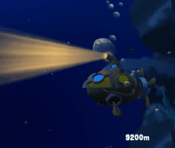

### Properties

| Properties     | Description                                               |
| -------------- | --------------------------------------------------------- |
| Source         | Add here the source game object to get the rotation data. |
| Angles Range X | Minimum and Maximum Rotation X Angles for scaling.        |
| Angles Range Y | Minimum and Maximum Rotation Y Angles for scaling.        |
| Angles Range Z | Minimum and Maximum Rotation Z Angles for scaling.        |
| Curve Scale X  | Uniform scale curve relative to the Angles X Range.       |
| Curve Scale Y  | Uniform scale curve relative to the Angles Y Range.       |
| Curve Scale Z  | Uniform scale curve relative to the Angles Z Range.       |

 

## Particle Scripts

### Overview

Those scripts are manipulating particles and particle systems.
 

## Particle Constant Position

### Overview

The particles get aligned between two vectors and can be manipulated by a sinus curve.
 

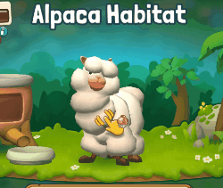

### Properties

| Properties             | Description                                       |
| ---------------------- | ------------------------------------------------- |
| Target Particle System | Particles to manipulate from the particle system. |
| End Position           | Vector of the second position.                    |
| Offset                 | Position offset.                                  |
| Phase                  | Phase of the particles' position.                 |
| Frequency              | Frequency of the particles' position.             |
| Amplitude              | Amplitude of the particles' position.             |

 

## Particle On Off Over Duration

### Overview

Deactivate one GameObject and activate another based on the duration of the particle system emitter.

### Properties

| Properties             | Description                                         |
| ---------------------- | --------------------------------------------------- |
| Source Particle System | Particle system that counts the duration to switch. |
| Off Object             | Disables the game object after a duration elapses.  |
| On Object              | Enables the game object after a duration elapses.   |

 

## Particle Position Sync

### Overview

This script synchronizes the target particles' position with the source position. Apply this script on any Game Object.

### Properties

| Properties             | Description                                      |
| ---------------------- | ------------------------------------------------ |
| Source Particle System | Source particle system.                          |
| Target Particle System | Particle systems to sync with the source.        |
| Rate Over Time         | Value should be the same as in the source.       |
| Burst Time             | Burst time should be the same as in the source.  |
| Burst Count            | Burst count should be the same as in the source. |
| Offset                 | Offset relative to velocity.                     |

 

## Particle System Force Field Controller

### Overview
This script dynamically changes the gravity property of a Particle System Force Field in Unity over time using an AnimationCurve. It is designed to provide a dynamic and animated effect to the associated Particle System.

### Properties

| Property           | Description                                          |
| ------------------ | ---------------------------------------------------- |
| Target Force Field | The force field to be animated.                      |
| Time Curve         | Animation curve to define gravity changes over time. |

 

## Shaders

### Overview

The shaders are vertex / pixel shaders written in CG.
 

> > **Note**
If you need them in HLSL, then you need to change the CG PROGRAM like here.
>  
Here some links:
> [Catlike Coding](https://catlikecoding.com/unity/tutorials/scriptable-render-pipeline/custom-shaders/)
>  
> [HLSL in Unity](https://docs.unity3d.com/Manual/SL-ShaderPrograms.html)
>  
> [Microsoft High-level shader language ](https://learn.microsoft.com/en-us/windows/win32/direct3dhlsl/dx-graphics-hlsl)
>  
> [Unity ShaderLab Code Blocks Documentation](https://docs.unity3d.com/Manual/shader-shaderlab-code-blocks.html)

  

### Global Render Properties

Except for UI shaders, all other shaders share common rendering properties. The following attributes define an object's
appearance during rendering.
> **Note**
> Store vertex alpha in the second UV at index [0].
> **Note**
> Some of the listed properties might not be utilized in the shaders..

| Render Properties                | Description                                                                                    |
| -------------------------------- | ---------------------------------------------------------------------------------------------- |
| Pre-multiplied Mode              | Black areas in the alpha will blend additively.                                                |
| Disable Vertex Alpha             | Disabling the vertex alpha which is stored in the second UV's first index (X).                 |
| Cull Mode                        | [Unity Documentation on Cull](https://docs.unity3d.com/Manual/SL-Cull.html)                    |
| Stencil Buffer                   | Configures the stencil buffer according to the given parameters.                               |
| Reference                        | [Unity Stencil Documentation](https://docs.unity3d.com/Manual/SL-Stencil.html)                 |
| Compare                          | [Unity Stencil Documentation](https://docs.unity3d.com/Manual/SL-Stencil.html)                 |
| Pass                             | [Unity Stencil Documentation](https://docs.unity3d.com/Manual/SL-Stencil.html)                 |
| Write                            | [Unity Stencil Documentation](https://docs.unity3d.com/Manual/SL-Stencil.html)                 |
| Read                             | [Unity Stencil Documentation](https://docs.unity3d.com/Manual/SL-Stencil.html)                 |
| Z Write                          | [Unity ZWrite Documentation](https://docs.unity3d.com/Manual/SL-ZWrite.html)                   |
| Z Test                           | [Unity ZTest Documentation](https://docs.unity3d.com/Manual/SL-ZTest.html)                     |
| Double Sided Global Illumination | [Material-doubleSidedGI](https://docs.unity3d.com/ScriptReference/Material-doubleSidedGI.html) |

## True Color Shaders

  

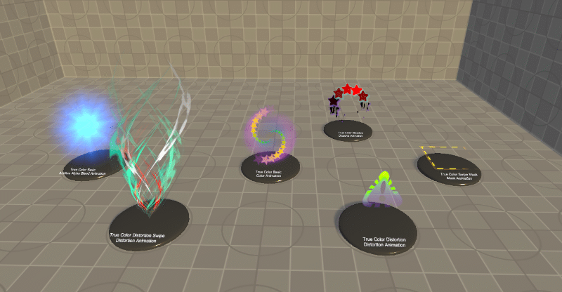
 

### Overview
True color shaders perform linear interpolation between two colors, guided by a mask. Another feature is to blend
between additive and pre-multiply mode, guided by black and white values. 
**Note** These shaders are outdated; the Multi Color shaders offer more features.
 

## Particle

### Overview

All true color particle shaders use Custom Data 1 and 2.
 

### Setup Particle System Vertex Stream

You need to set up the vertex stream in your particle system.

| Properties                                                                                                                                                                   | Description                                                                        |
| ---------------------------------------------------------------------------------------------------------------------------------------------------------------------------- | ---------------------------------------------------------------------------------- |
| 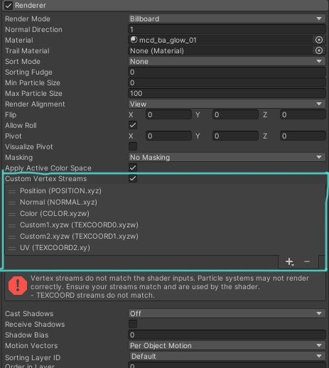 | Set up Vertex Stream for billboards and stretch particles as shown in the picture. |
| 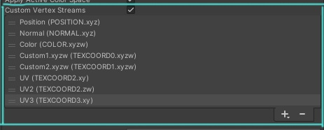 | Set up Vertex Stream for mesh particles as shown in the picture.                   |
| 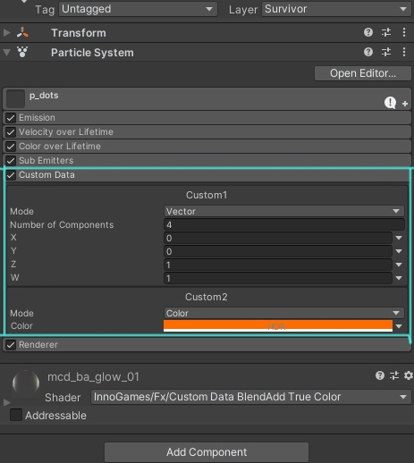                  | Enable and set Custom Data 1 and 2 as vectors and colors as shown in the picture.  |

 

## Base

### Overview

This shader includes the true color features.

### Base Properties

| Properties     | Description                                                                                          |
| -------------- | ---------------------------------------------------------------------------------------------------- |
| Transform      | UV tiling and offset are used to repeat and shift the position of the alpha texture.                 |
| Packed Texture | It stores different masks in the channels, which are used as alpha. Only RGB channels are supported. |

 

## Dissolve

### Overview

This shader is based on the true color particle base shader with an additional dissolve feature.

### Base Properties

| Properties     | Description                                                                                          |
| -------------- | ---------------------------------------------------------------------------------------------------- |
| Transform      | UV tiling and offset are used to repeat and shift the position of the alpha texture.                 |
| Packed Texture | It stores different masks in the channels, which are used as alpha. Only RGB channels are supported. |

### Dissolve Properties

| Properties | Description                                                                       |
| ---------- | --------------------------------------------------------------------------------- |
| Invert     | Invert the ramp texture values.                                                   |
| Fall Off   | Change the values from the ramp. Higher values will give hard edge results.       |
| Transform  | UV tiling and offset are used to repeat and shift the position of the ramp map.   |
| Ramp Map   | Map with gradient information that controls the direction of the dissolve effect. |

 

## Distortion

### Overview

This shader is designed for creating dynamic visual effects using distortion techniques and customizable color blending. It uses textures and parameters to control transparency, blending, and distortion based on user input.

### Properties

| Property             | Description                               |
| -------------------- | ----------------------------------------- |
| Alpha Texture        | Alpha texture for transparency control.   |
| Mask Texture         | Mask texture to define effect areas.      |
| Invert Mask          | Toggle to invert the mask effect.         |
| Blend Red Channeld   | Control blending intensity for red.       |
| Blend Green Channel  | Control blending intensity for green.     |
| Blend Blue Channel   | Control blending intensity for blue.      |
| Distortion Map       | Texture used for distortion effects.      |
| Disable Vertex Alpha | Disable vertex color alpha influence.     |
| Z Test               | Depth comparison function for visibility. |

 

## Swipe Distortion

### Overview
This shader manipulates particle visuals by applying distortion and color blending effects based on various texture inputs, suitable for creating dynamic particle effects in VFX-heavy applications.

### Properties

| Property             | Description                                                               |
| -------------------- | ------------------------------------------------------------------------- |
| Alpha Texture        | Texture influencing alpha transparency, affecting visibility.             |
| Mask                 | Defines areas where shader effects are altered, enhancing detail control. |
| Blend Red Channel    | Controls intensity of red channel contributions to final color.           |
| Blend Green Channel  | Controls intensity of green channel contributions to final color.         |
| Blend Blue Channel   | Controls intensity of blue channel contributions to final color.          |
| Distortion Texture   | Provides a pattern or map for creating distortion effects on particles.   |
| Dissolve Hardness    | Determines the sharpness or intensity of dissolve effects.                |
| Disable Vertex Alpha | Enables or disables vertex color alpha influence on the shader's output.  |
| ZTest                | Sets the GPU's depth testing, determining how content is layered.         |

 

## Swipe Mask

### Overview

This shader uses custom data to manipulate texture swiping and coloring, aiming to enhance visual effects by adjusting textures based on dynamic inputs.

### Properties

| Property             | Description                                         |
| -------------------- | --------------------------------------------------- |
| Texture              | Main texture for effect application.                |
| Mask Texture         | Mask texture to define areas of effect application. |
| Disable Vertex Alpha | Disable Vertex Alpha (boolean switch).              |
| Z Test               | Depth test comparison function setting.             |

 

## Image Shaders

  

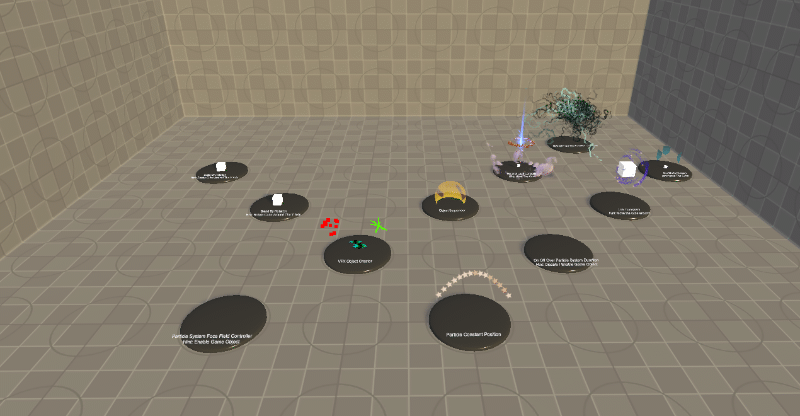
 

### Overview

The image shaders are specially designed to be used by other artists, such as UI or non-technical / VFX artists. This
shader is intended to be used with a UI image.
 

> > **Note**
> If you are using a atlas, you might need a script that passes UV coordinates from the atlas into the shader.

 

## Cascade

### Overview

This shader transitions the image from one state to its actual picture.
 

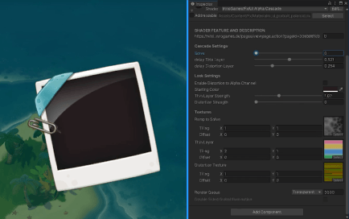

### Cascade Properties

| Properties       | Description                                                                           |
| ---------------- | ------------------------------------------------------------------------------------- |
| Solve            | Solves the following layers in this order: color layer, thin layer, distortion layer. |
| Delay Thin Layer | Delays solving the layer relative to the state of the solve properties.               |
| Delay Distortion | Delays solving the layer relative to the state of the solve properties.               |

### Layer Properties

| Properties            | Description                                                |
| --------------------- | ---------------------------------------------------------- |
| Color                 | Color Layer                                                |
| Thin Strength         | Blend strength of the thin layer.                          |
| Distortion Strength   | Distortion strength.                                       |
| Distort Alpha Channel | If enabled, the distortion will respect the alpha channel. |

### Texture Properties

| Properties     | Description                                                                       |
| -------------- | --------------------------------------------------------------------------------- |
| Ramp           | Ramp texture                                                                      |
| Color          | Color texture for the thin layer                                                  |
| Distortion Map | Map with vector information applied to the UVs for directional distortion effect. |

 

## Fluid 2D

### Overview

This shader is engineered for creating dynamic, fluid-like visual effects on UI elements, using texture blending, animated movements, and sophisticated shading techniques. For more details check the Fluid shader in Special shaders.

### Properties

| Properties               | Description                                         |
| ------------------------ | --------------------------------------------------- |
| Main Texture             | Primary texture for the shader.                     |
| Enable Shader            | Enable or disable the shader effect.                |
| Fusion Strength          | Strength of the fusion effect between textures.     |
| Tint Color               | Tint color for the main image.                      |
| Blend Edge               | Intensity of the edge blending effect.              |
| Tint Edge                | Tint color for edges.                               |
| Blend Glow               | Intensity of the glow effect.                       |
| Tint Glow                | Tint color for glow effects.                        |
| Swipe Source and Target  | Controls the swiping animation of the textures.     |
| Swipe Glow and Direction | Controls the direction and speed of glow swipe.     |
| Fusion Source            | Fusion source texture.                              |
| Source Offset and Scale  | Offset (X & Y), Scale (Z & W) for source texture.   |
| Blend Channel Source     | Blend Channel (X & Y & Z) for source texture.       |
| Fusion Target            | Fusion target texture.                              |
| Target Offset and Scale  | Offset (X & Y), Scale (Z & W) for target texture.   |
| Blend Channel Target     | Blend Channel (X & Y & Z) for target texture.       |
| Glow Mask                | Texture that defines areas for glow effects.        |
| Glow Offset and Scale    | Offset (X & Y), Scale (Z & W) for glow texture.     |
| Stencil Comparison       | Stencil comparison function.                        |
| Stencil ID               | Stencil ID for operations.                          |
| Stencil Operation        | Stencil operation to perform.                       |
| Stencil Write Mask       | Stencil write mask.                                 |
| Stencil Read Mask        | Stencil read mask.                                  |
| Color Mask               | Color channels that are written to the framebuffer. |

 

## Glitch

### Overview

This shader creates a glitch effect, like a TV glitch. By default, it is set up with textures and a distortion map that
creates a cartoon style. For a different style, simply change the textures.
 

### Jitter Properties

| Properties | Description            |
| ---------- | ---------------------- |
| Amplitude  | Jitter strength value. |
| Frequency  | Jitter frequency.      |

### Distortion Properties

| Properties           | Description                 |
| -------------------- | --------------------------- |
| Distortion Frequency | Distortion frequency.       |
| Distortion Speed X   | Swipe value for the U axis. |
| Distortion Speed Y   | Swipe value for the V axis. |

### Color Properties

| Properties                   | Description                                  |
| ---------------------------- | -------------------------------------------- |
| Enable Tint                  | Activate image tinting.                      |
| Tint Strength                | Blend strength value.                        |
| Flickering Frequency         | Flickering frequency.                        |
| Multiply or Add Tint Texture | Blend between multiplied or additive tinting |
| Desaturation Strength        | Increase or decrease image desaturation.     |

 

## Desaturation

### Overview

This shader desaturates the original image. For performance reasons, this shader doesn't use a typical HSL function.
Instead, the shader returns each color channel individually to create a grayscale effect.

### Properties

| Properties              | Description                                         |
| ----------------------- | --------------------------------------------------- |
| Strength                | Blend between the original and grayscale.           |
| Source Texture Channels | Vector specifying contribution to grayscale effect. |

 

## Shine

### Overview

This shader generates a shine effect guide by a mask.

### Main Properties

| Properties          | Description                         |
| ------------------- | ----------------------------------- |
| Enable Shine        | Activate the shine effect.          |
| Enable Transparency | Alpha channel affects shine effect. |

### Shading Properties

| Properties | Description                      |
| ---------- | -------------------------------- |
| Tint Glow  | Color for the shine effect.      |
| Blend Glow | Control shine effect visibility. |

### Animation Properties

| Properties                     | Description          |
| ------------------------------ | -------------------- |
| Delay                          | Defines delay.       |
| Swipe X and Y, Set Direction Z | Frequency of jitter. |

### Texture Properties

| Properties      | Description            |
| --------------- | ---------------------- |
| Glow Mask       | Jitter strength value. |
| Tiling & Offset | Jitter frequency.      |

 

## Specialized Shaders
  

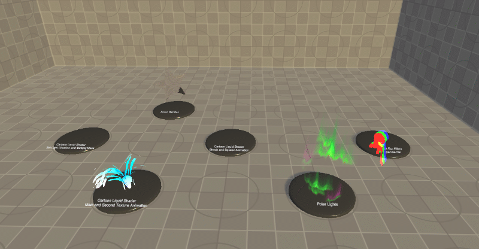
 

### Overview
Specialized shaders are made for just one purpose; they combine different VFX features but are designed to support only one specific type of effect, for example, just to generate fluids.

## Fake Eco Experimental

### Overview

This shader manipulates visual effects by animating offsets and colors dynamically across three passes, each applying a distinct color (red, green, blue) with varying opacities based on position and animation parameters.

### Properties

| Property   | Description                       | Type   | Default Value        |
| ---------- | --------------------------------- | ------ | -------------------- |
| _OffsetMin | Minimum offset values for XYZW    | Vector | (0.0, 0.0, 0.0, 0.0) |
| _OffsetMax | Maximum offset values for XYZW    | Vector | (1.0, 1.0, 1.0, 1.0) |
| _Animation | Controls the animation parameters | Vector | (0.0, 0.0, 0.0, 0.0) |
 

## Polar Lights"

###  Overview

This shader is designed to create dynamic polar light effects using advanced texture manipulation and blending techniques, ideal for atmospheric and celestial phenomena.

### Properties

| Property Name                | Description                                                                     |
| ---------------------------- | ------------------------------------------------------------------------------- |
| Look Up Table                | Defines color transformations and intensity variations for the polar lights.    |
| Alpha Texture                | Controls transparency and additional effects through RGB channels.              |
| Blend Packed Texture Channel | Defines how each channel of the Alpha texture contributes to the final effect.  |
| ZTest                        | Controls depth comparison to ensure correct layering with other scene elements. |

 

## Specialized Particle

## Fluid

### Overview

This shader is mainly for fluid effects. It is based on the fusion concept. It is a concept that I created to make
simple fluid effects for mobile productions.
 

 

#### Fusion Concept!

The fusion concept essentially involves merging two grayscale ramps and subsequently subtracting the grayscale values
with another value. After this, the values are multiplied by 100 to regain sharp edges while maintaining smooth, rounded
shapes. With additional motion applied to each ramp, and this way, you can create a fluid-like animation. For good
results, the grayscale ramp should be soft.
 

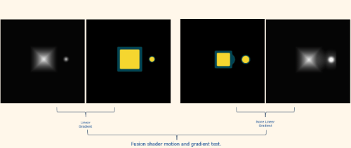
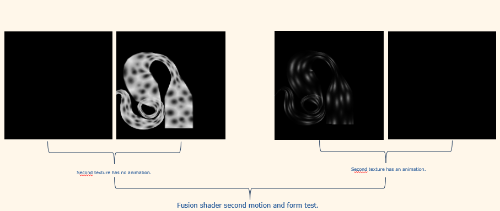

### Main Texture Properties

| Properties                                      | Description                                                                                                 |
| ----------------------------------------------- | ----------------------------------------------------------------------------------------------------------- |
| Multiply to Mask                                | If this is enabled, the mask will be multiplied to the alpha, affecting the fusion effect.                  |
| Use Custom Data 2 (Z, W) For Stretch And Squash | Enabling this feature allows you to control the tiling of a texture using custom data 2's Z and W channels. |
| Blend Channels                                  | XYZ values blend the different RGB channels.                                                                |
| Tiling / Offset                                 | UV tiling and offset are used to repeat and shift the position of the texture.                              |
| Packed Texture                                  | It stores different masks in the channels, which are used as alpha. Only the RGB channels are supported.    |

### Second Texture Properties

| Properties                                      | Description                                                                                                 |
| ----------------------------------------------- | ----------------------------------------------------------------------------------------------------------- |
| Use Custom Data 2 (Z, W) For Stretch And Squash | Enabling this feature allows you to control the tiling of a texture using custom data 2's Z and W channels. |
| Blend Channels                                  | XYZ values blend the different RGB channels.                                                                |
| Tiling / Offset                                 | UV tiling and offset are used to repeat and shift the position of the texture.                              |
| Packed Texture                                  | It stores different masks in the channels, which are used as alpha. Only the RGB channels are supported.    |

### Mask Properties

| Properties      | Description                                                                    |
| --------------- | ------------------------------------------------------------------------------ |
| Shrink Mask     | This value is applied to the mask texture.                                     |
| Tiling / Offset | UV tiling and offset are used to repeat and shift the position of the texture. |
| Mask            | Map with grayscale information to mask the alpha.                              |

### Fusion Properties

| Properties                 | Description                                                                                                      |
| -------------------------- | ---------------------------------------------------------------------------------------------------------------- |
| Use Standard Alpha of Life | The alpha from particles will not be multiplied into the fusion effect; it will be used as a normal alpha blend. |
| Fusion Strength            | This value controls how much will be subtracted from the alpha.                                                  |
| Alpha Blend                | Transparency strength.                                                                                           |
| Edge Blend                 | Blends the edge.                                                                                                 |
| Edge Tint                  | Tints the edge.                                                                                                  |
| Edge Brightness            | Controls the brightness of the edge.                                                                             |

### Light Properties

| Properties      | Description                                |
| --------------- | ------------------------------------------ |
| Light Enable    | Enables the light source.                  |
| Light Direction | Sets the position of the light source.     |
| Shadow Color    | Sets the color value for the shadow areas. |
| Shadow Blend    | Strength of the shadow visibility.         |

 

## Multi Dynamic

### Overview

This shader combines different dynamics and motion together, for example dissolving, distortions, UV sweeps, etc. The
dynamics are controlled by the custom data from the particle system Shuriken. You will also need meshes; the UV should
be warped in one direction (U or V). 
**Notep** This is a very limited shader; it provides more or less the same features as the MultiColor Particle Shader but in a very optimized and limited way. 
It doesn't support Compute features like the Multi Color shaders. It is recommended to use the MultiColor Particle Shader instead.
 

### Debug Properties

The shader is quite complex, and during production, you can sometimes lose the overview of what the features are doing.
For that reason, I've built these debug properties to provide a better understanding of what the shader is doing. These
properties generate a new compute shader. After you've finished debugging, don't forget to disable the 'Compute Debug
Mode', as this enables and disables all debug modes.

| Properties         | Description                          |
| ------------------ | ------------------------------------ |
| Compute Debug Mode | Computes all debug features.         |
| Debug Glow         | Visualizes the glow feature.         |
| Debug Color        | Visualizes the color feature.        |
| Debug Alpha        | Visualizes the alpha feature.        |
| Debug Vertex Alpha | Visualizes the vertex alpha feature. |
| Debug Mask         | Visualizes the mask feature.         |
| Debug Dissolve     | Visualizes the dissolve feature.     |
| Debug Distortion   | Visualizes the distortion feature.   |

### Shading Properties

| Properties                | Description                                                                 |
| ------------------------- | --------------------------------------------------------------------------- |
| Use Red Channel As Glow   | Blends the red channel of the texture.                                      |
| Use Green Channel As Glow | Blends the green channel of the texture.                                    |
| Use Blue Channel As Glow  | Blends the blue channel of the texture.                                     |
| Additive Tint Color       | Determines how much the tint color should be additive blend.                |
| Additive Blend            | Blends between pre-multiplied and additive mode.                            |
| Color Ramp                | A ramp relative to the U axis, blending between the first and second color. |
| Second Color              | Sets the second color value.                                                |
| Ramp Blend                | The strength of the ramp.                                                   |
| Ramp Offset               | Offsets the ramp at the U axis.                                             |
| Ramp Multiplier           | Controls the gradient of the ramp.                                          |

### Alpha Properties

| Properties           | Description                                                                                           |
| -------------------- | ----------------------------------------------------------------------------------------------------- |
| UV Flip U            | Flips the UV coordinates horizontally.                                                                |
| UV Flip V            | Flips the UV coordinates vertically.                                                                  |
| UV Rotate 90 Degrees | Rotates the UV coordinates by 90 degrees.                                                             |
| Invert Swirl         | Inverts the direction of the swirl.                                                                   |
| Swirl Direction U    | Sets the swirl direction.                                                                             |
| Blend Channels       | Blends the different channels' XYZ values of RGB.                                                     |
| Transform            | Uses UV tiling and offset to repeat and shift the texture's position.                                 |
| Packed Texture       | Stores different masks in the channels, which are used as alpha. Only the RGB channels are supported. |

### Mask Properties

| Properties                          | Description                                                                 |
| ----------------------------------- | --------------------------------------------------------------------------- |
| UV Flip U                           | Flips the UV coordinates horizontally.                                      |
| UV Flip V                           | Flips the UV coordinates vertically.                                        |
| UV Rotate 90 Degrees                | Rotates the UV coordinates by 90 degrees.                                   |
| Overwrite Custom Data X for Stretch | If enabled, custom data X will tile the U coordinates from the mask map.    |
| Overwrite Custom Data Y for Swipe   | If enabled, custom data X will offset the U coordinates from the mask map.  |
| Transform                           | Uses UV tiling and offset to repeat and shift the position of the mask map. |
| Mask                                | Map with grayscale information to mask the alpha.                           |

### Dissolve Properties

| Properties           | Description                                                                    |
| -------------------- | ------------------------------------------------------------------------------ |
| UV Flip U            | Flips the UV coordinates horizontally.                                         |
| UV Flip V            | Flips the UV coordinates vertically.                                           |
| UV Rotate 90 Degrees | Rotates the UV coordinates by 90 degrees.                                      |
| Invert               | Inverts the gradients of the dissolve map.                                     |
| Fall Off             | Changes the values from the ramp; higher values will give hard edge results.   |
| Transform            | Uses UV tiling and offset to repeat and shift the position of the map.         |
| Ramp                 | Map with gradient information to control the direction of the dissolve effect. |

### Distortion Properties

| Properties          | Description                                                                               |
| ------------------- | ----------------------------------------------------------------------------------------- |
| Enable for Alpha    | Applies distortion to the alpha texture.                                                  |
| Enable for Dissolve | Applies distortion to the dissolve map.                                                   |
| Enable for Mask     | Applies distortion to the mask map.                                                       |
| Transform           | Uses UV tiling and offset to repeat and shift the texture's position.                     |
| Distortion Map      | Map with vector information applied to the UVs to create a directional distortion effect. |

 

## Screen Position Distortion"

### Overview

This shader applies screen-space distortion effects to particles, suitable for creating dynamic environmental visual effects.

### Properties

| Property Name                       | Description                                                 |
| ----------------------------------- | ----------------------------------------------------------- |
| Distortion Texture                  | Defines the distortion pattern.                             |
| Distortion Set World Uv Coordinates | Toggle to use world coordinates for distortion UVs.         |
| Distortion Strength                 | Controls the intensity of the distortion effect.            |
| Distortion Uv Tiling & Offset       | Manages tiling and offset for the distortion texture.       |
| Distortion Mask                     | Defines where distortion is applied selectively.            |
| Enable Rim Mask                     | Toggle to apply rim masking to the distortion edges.        |
| Distortion Mask Invert              | Toggle to invert the areas affected by the distortion mask. |
| Rim Mask Multiplier                 | Adjusts the rim mask's multiplication factor.               |
| Rim Mask Hardness                   | Controls the hardness of the rim mask.                      |
| Distortion Mask Uv Tiling & Offset  | Manages tiling and offset for the distortion mask.          |

 

## Multi Color Shaders

  

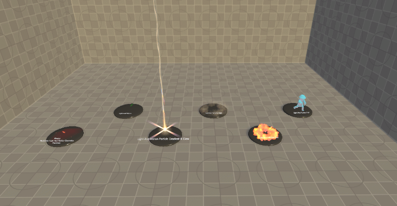
 

### Overview
Multi-color shaders use color ramps relative to grayscale values of the texture to colorize it. The alpha of the ramp
controls the additive and pre-multiply blend.
 

## Light And Motion"

### Overview
These latest shaders on the list are compute shaders, with features that can be enabled and disabled. The Multi Color shaders use a color ramp, which provides greater flexibility in the development of the look and feel. 
They have the most VFX features, like adding light gradients, distortions, dissolving, sweeping, etc. 
This shader has fewer features than the Particle Version, and the animation of some features is time-related. 

For more details about the features, check the [Light And Motion Particle](#light-and-motion-particle).

### Key Time-Related Properties

### Deformation Phase and Deformation Amplitude
These properties manage the timing and magnitude of geometry deformations, animating object shapes according to internal shader timing (_Time.y). This allows for effects such as pulsating structures, undulating terrains, or dynamic object morphing.

### LUT Animate Offset, X min, Y max range, Z speed
This property dictates the animation of a Color Look-Up Table (LUT), which adjusts color grading dynamically. It sets the start and end points of the animation within the LUT and controls the speed at which this transition occurs, facilitating color transitions that can reflect different times of day or special effects.

### UV Ramp Settings and UV Ramp Axis Blend
These properties adjust the calculation and blending of UV gradients over time, enabling advanced texture mapping such as animated flows or progressive reveals on surfaces. This could be used to simulate moving clouds on a sky dome or water currents on a river.

### Dissolve Strength and Dissolve Fall Off
Used for dynamic dissolve effects, these settings control the intensity and the gradient of how materials appear to dissolve over time. Such effects are useful for depicting objects transitioning between states, such as disintegration or fading out.

### Alpha Mask Speed Squeeze XY & Swipe ZW
This property manipulates the alpha mask dynamically, affecting texture visibility in an animated fashion. It’s crucial for effects where texture exposure changes over time, such as revealing or obscuring parts of an object according to specific gameplay events.

## Multi Color Particle

 

## Light and Motion Particle

### Overview

This shader is a multifunctional for VFX Artists, enabling the creation of diverse and dynamic visual effects through a
modular and customizable approach. It covers a broad spectrum of VFX needs, from geometry and UV manipulation, lighting
and shading, to dissolve and distortion effects.
 

 

### Compute Properties

| Properties                   | Description                                              |
| ---------------------------- | -------------------------------------------------------- |
| Compute Geometry             | Computes geometry features.                              |
| Compute Geometry and Texture | Adds texture features to the geometry features.          |
| Compute Gradient by Uv       | Computes gradient features.                              |
| Compute Uv Manipulate        | Computes UV transform features.                          |
| Compute Dissolve             | Computes dissolve features.                              |
| Compute Dissolve Clip        | Adds an alpha clipping feature to the dissolve features. |
| Compute Distortion           | Computes distortion features.                            |

### Geometry Properties

| Properties                        | Description                                              |
| --------------------------------- | -------------------------------------------------------- |
| Rim Multiplier                    | Strength of the rim effect.                              |
| Rim Hardness                      | Controls the hardness of the fall-off from the rim.      |
| Rim Blend                         | Controls how much the rim is visible.                    |
| Deforming Frequency               | Controls the frequency of the sinus curve.               |
| Deforming Amplitude               | Controls the strength of the sinus curve.                |
| Deformation Axis                  | Translates the geometry to deform it.                    |
| Push Axis                         | Pushes the geometry along the normals.                   |
| Geo Offset Use Custom Data 1      | Switch to control deformation strength by custom data 1. |
| Geo Offset By CD1 Channel (0 - 3) | Sets deformation strength by custom data 1 channel.      |

### Glow Properties

| Properties                     | Description                                                          |
| ------------------------------ | -------------------------------------------------------------------- |
| Tint Glow                      | Sets the color of the glow.                                          |
| Use Custom Data 1              | Switch to control the visibility of the gradient using custom data1. |
| Strength by CD1 Channel        | Select a custom data channel from 0 to 3 to determine the strength.  |
| Strength                       | Controls the overall strength of the glow.                           |
| Glow Blend From Gradient       | Gradient features control the visibility of the glow.                |
| Glow Blend From LUT Alpha      | Look Up Texture features controls the visibility of the glow.        |
| Glow Blend From Alpha Channels | Alpha Channels features control the visibility of the glow.          |
| Glow Blend From Alpha Mask     | Alpha Mask features control the visibility of the glow.              |
| Glow Blend From Rim            | Rim features control the visibility of the glow.                     |
| Rim Invert                     | Inverts the rim effect.                                              |
| Rim Multiplier                 | Controls the strength of the rim effect.                             |
| Rim Hardness                   | Controls the hardness of the fall-off from the rim.                  |

### World Position Mask Properties

| Properties                          | Description                                                     |
| ----------------------------------- | --------------------------------------------------------------- |
| Enable World Position Mask          | Multiplies the world position gradient in to the alpha channel. |
| Set Look Up Table To World Position | Transfers the LUT colors in to the WP gradient.                 |
| World Position Mask Axis            | Set direction of the WP mask.                                   |
| World Position Mask Offset          | Translate the world position.                                   |
| World Position Mask Multiplier      | Strength of the WP gradient.                                    |
| World Position Hardness             | Sharpness of the WP gradient.                                   |

### Gradient Properties

| Properties              | Description                                                          |
| ----------------------- | -------------------------------------------------------------------- |
| Color                   | Sets the color of the gradient.                                      |
| Strength                | Controls the strength of the gradient.                               |
| Brightness              | Controls the visibility of the gradient.                             |
| Blend Use Custom Data 1 | Switch to control the visibility of the gradient using custom data1. |
| CD1 Channel (0 - 3)     | Select a custom data channel from 0 to 3 for gradient adjustments.   |
|                         |                                                                      |
| Gradient by Light       | When enabled, the gradient adopts normal light behavior.             |
| Convert To A Light      | Converts gradient influence to mimic lighting effects.               |
| Set Position            | Sets the local position for gradient-based lighting calculations.    |
| Light Position          | Sets the Light position relative to the local position.              |
| Light Range             | Controls the range of the light effect.                              |
| Light Fall Off          | Higher values will create higher fall off range.                     |
| Light Hardness          | Higher values will reduce the fall off.                              |
|                         |                                                                      |
| Gradient by UV          | Adjusts gradient effects based on UV mapping coordinates.            |
| UV Ramp Axis Blend      | Defines on which direction the gradient should be created.           |
| UV Ramp Offset          | Translates the UV per axis.                                          |

### Shading Properties

| Properties                   | Description                                                                            |
| ---------------------------- | -------------------------------------------------------------------------------------- |
| Look Up Table                | Map with a color gradient from left to right.                                          |
| Switch LUT to Color Gradient | Gradient color will be replaced by the LUT.                                            |
| Multiply Particle Color      | Particle / vertex colors will be added to mesh / particles.                            |
| Use custom data 1            | Switch to control the v offset. For example, to animate between two or more gradients. |
| CD1 Channel (0 - 3)          | Select a custom data channel from 0 to 3.                                              |

### Alpha Properties

| Properties                        | Description                                                                                                                                                                 |
| --------------------------------- | --------------------------------------------------------------------------------------------------------------------------------------------------------------------------- |
| Enable Alpha Mask                 | Activates the alpha mask properties.                                                                                                                                        |
| Disable Alpha                     | The packed texture will be extracted from alpha. This is used to disconnect the grayscales from alpha and just use it for the colors. The alpha mask can replace the alpha. |
| Packed Texture                    | Stores different masks in the channels, which are used as alpha.                                                                                                            |
| Blend Packed Texture Channels     | Blends the different channels' XYZ values of RGB.                                                                                                                           |
| UV Tiling & Offset                | Uses UV tiling and offset to repeat and shift the texture’s position.                                                                                                       |
| Alpha Mask                        | Texture with grayscale information to define where and to what extent the visibility should be applied.                                                                     |
| Use Alpha UV                      | Enables UV tiling and offset from packed textures.                                                                                                                          |
| Enable Squeeze XY & Swipe ZW      | With a value of 1, it enables the use of a custom data value for squeezing and swiping the UV.                                                                              |
| Use Custom Data 1 Channel (0 - 3) | Select a custom data channel from 0 to 3.                                                                                                                                   |

### Dissolve Properties

| Properties                                  | Description                                                                                           |
| ------------------------------------------- | ----------------------------------------------------------------------------------------------------- |
| Map                                         | Texture with grayscale information to define where and to what extent the dissolve should be applied. |
| Flip U                                      | Flips the UV coordinates horizontally.                                                                |
| Flip V                                      | Flips the UV coordinates vertically.                                                                  |
| Rotate 90 Degrees                           | Rotates the UV coordinates by 90 degrees.                                                             |
| Use Alpha Uv                                | Uv Tiling & Offset will used from packed textures.                                                    |
| Invert Ramp                                 | Inverts the gradients of the dissolve map.                                                            |
| Use Custom Data 1                           | With a value of 1, it enables the use of a custom data value for the dissolve strength.               |
| Strength By Use Custom Data Channel (0 - 3) | Select a custom data channel from 0 to 3.                                                             |
| Strength                                    | Controls the strength of the dissolve effect.                                                         |
| Uv Tiling & Offset                          | Uses UV tiling and offset to repeat and shift the texture’s position.                                 |
| Fall Off                                    | Changes the values from the map higher values will give hard edge results.                            |

### Distortion Properties

| Properties                                  | Description                                                                                             |
| ------------------------------------------- | ------------------------------------------------------------------------------------------------------- |
| Map                                         | Texture with vector information applied to the UVs to create a directional distortion effect.           |
| Mask                                        | Texture with grayscale information to define where and to what extent the distortion should be applied. |
| Mask Invert                                 | Distortion will be applied to the alpha texture.                                                        |
| Enable For Alpha                            | Uses UV tiling and offset to repeat and shift the position of the texture.                              |
| Enable For Dissolve                         | Distortion will be applied to the dissolve map.                                                         |
| Use Custom Data 1                           | With a value of 1, it enables the use of a custom data value for the distortion strength.               |
| Strength By Use Custom Data Channel (0 - 3) | Select a custom data channel from 0 to 3.                                                               |
| Strength                                    | Controls the strength of the distortion effect.                                                         |
| Set Uv To World Coordinates                 | Set the uv’s in to world coordinates.                                                                   |
| Uv Tiling & Offset                          | Uses UV tiling and offset to repeat and shift the texture’s position.                                   |

### UV Manipulate Properties

| Properties                        | Description                                                                                                                                           |
| --------------------------------- | ----------------------------------------------------------------------------------------------------------------------------------------------------- |
| Uv Alpha                          |                                                                                                                                                       |
| Enable Squeeze XY and Swipe ZW    | With a value of 1, it enables the use of a custom data value for squeezing and swiping the UV.                                                        |
| Use Custom Data 1 Channel (0 - 3) | Select a custom data channel from 0 to 3.                                                                                                             |
|                                   |                                                                                                                                                       |
| Uv Distortion                     |                                                                                                                                                       |
| Enable Squeeze XY and Swipe ZW    | With a value of 1, it enables the use of a custom data value for squeezing and swiping the UV.                                                        |
| Use Custom Data 1 Channel (0 - 3) | Select a custom data channel from 0 to 3.                                                                                                             |
|                                   |                                                                                                                                                       |
| Uv Twist                          |                                                                                                                                                       |
| Invert U                          | Is inverting the u direction.                                                                                                                         |
| Invert V                          | Is inverting the v direction.                                                                                                                         |
| Alpha Use Custom Data             | Adding the twist effect to the alpha texture.                                                                                                         |
| Dissolve Use Custom Data          | Adding the twist effect to the distortion map.                                                                                                        |
| Twist                             | Controls the strength of the twist. If the Use Custom Data is Enabled.   The four values becomes a switcher to activate the custom channel usage. |
| Use Custom Data 1 Channel (0 - 3) | Select a custom data channel from 0 to 3.                                                                                                             |

 

## Light and Volume

### Overview
Control how different layers within the volume shader interact with light and depth to enhance three-dimensional effects.

 

### Shading Properties

| Properties          | Description                                     |
| ------------------- | ----------------------------------------------- |
| Z Write Solid Layer | Layer will be rendered in depth buffer.         |
| Blend Solid Layer   | Controls the visibility of the solid layer.     |
| Squeeze Solid Layer | Push the polys backwards along the normals.     |
| Z Write Blur Layer  | Layer will be rendered in depth buffer.         |
| Blend Blur Layer    | Controls the visibility of the solid layer.     |
| Rim Multiplier      | Strength of the fresnel effect.                 |
| Rim Hardness        | Higher values will create a sharper rim effect. |
| Look Up Table       | Gradient to colorize the light.                 |

### Light Properties

| Properties                   | Description                                                          |
| ---------------------------- | -------------------------------------------------------------------- |
| Set Position                 | Set the local position.                                              |
| Light Source Position        | Sets the Light position relative to the local position.              |
| Use Look Up Texture As Color | Controls the strength of the adding effect.                          |
| Blend Use Custom Data 1      | Switch to control the visibility of the gradient using custom data1. |
| Blend by CD1 Channel (0 - 3) | Select a custom data channel from 0 to 3.                            |
| Convert To A Light           | When this is enabled, the gradient adopts normal light behavior.     |
| Light Range                  | Controls the range of the light.                                     |
| Light Fall Off               | Higher values will create higher fall off range.                     |
| Light Hardness               | Higher values will reduce the fall off.                              |
| Color                        | Sets the light color.                                                |
| Strength                     | Controls the visibility of the gradient.                             |
| Gradient Brightness          | Controls the strength of the adding effect.                          |

### Temperature Properties

| Properties                      | Description                                                                             |
| ------------------------------- | --------------------------------------------------------------------------------------- |
| Temperature Multiplier          | Sets the range of Heat.                                                                 |
| Temperature Hardness            | Sets the strength of the heat.                                                          |
| Heat Color                      | Is tinting the heat area.                                                               |
| Heat Color Multiplier           | Overdrive the color values to generate glow.                                            |
| Temperature Map                 | Grayscale texture to dissolve and to control the strength of the heat.                  |
| Temperature Direction Map       | Additional Grayscale texture to control the global dissolve direction.                  |
| Flip U                          | Set the local position.                                                                 |
| Flip V                          | Set’s the Light position relative to the local position.                                |
| Rotate 90 Degrees               | Controls the range of the light.                                                        |
| Invert Map                      | With a value of 1, it enables the use of a custom data value for the dissolve strength. |
| Use Custom Data 1               | Select a custom data channel from 0 to 3.                                               |
| Strength by CD1 Channel (0 - 3) | Controls the strength of the dissolve effect.                                           |
| Strength                        | Controls the strength of the dissolve effect.                                           |
| UV Tiling & Offset              | Uses UV tiling and offset to repeat and shift the texture’s position.                   |
| Fall Off                        | Changes the values from the ramp; higher values will give hard edge results.            |

## Multi Color Ui

### Multi Color Particle
### Overview
**NOTE:** For this UI Particle shader you will need the 'Particle Effect For GUI' scripts from mob-sakai. 
Here the link to the repo. https://github.com/mob-sakai/ParticleEffectForUGUI?tab=MIT-1-ov-file

With this particle, you sort the particles by layering them in the hierarchy.

| Category                 | Property Name                              | Description                                             |
| ------------------------ | ------------------------------------------ | ------------------------------------------------------- |
| Compute Features         | Compute Debug                              | Toggle for enabling debug visualizations.               |
|                          | Compute Uv Manipulate                      | Toggle to enable UV manipulations for effects.          |
|                          | Compute Dissolve                           | Toggle to enable dissolve effects.                      |
|                          | Compute Distortion                         | Toggle to enable distortion effects.                    |
| Debug Features           | Visualize Dissolve                         | Toggle to visualize the dissolve effect.                |
|                          | Visualize Distortion                       | Toggle to visualize the distortion effect.              |
|                          | Visualize Distortion Mask                  | Toggle to visualize the distortion mask.                |
| Look and Feel            | Look Up Table                              | Look Up Table for color grading.                        |
|                          | Switch LUT to Color Gradient               | Switch between LUT and color gradient.                  |
|                          | Select Ramp                                | Selector for different color ramps.                     |
| Alpha Properties         | Packed Texture                             | Main texture for alpha manipulation.                    |
|                          | Blend Packed Texture Channel               | Vector for blending packed texture channels.            |
|                          | Uv Tiling & Offset                         | UV tiling and offset for alpha textures.                |
|                          | Uv Alpha Enable Squeez XY & Swipe ZW       | Enables squeezing and swiping for alpha UVs.            |
|                          | Uv Alpha Use Custom Data 1 Channel (0 - 3) | Channels for custom data use in UV alpha manipulation.  |
| Dissolve Properties      | Dissolve Ramp                              | Texture used for the dissolve ramp.                     |
|                          | Dissolve Flip U                            | Toggle to flip dissolve effect horizontally.            |
|                          | Dissolve Flip V                            | Toggle to flip dissolve effect vertically.              |
|                          | Dissolve Rotate 90 Degrees                 | Toggle to rotate dissolve texture by 90 degrees.        |
|                          | Dissolve Invert Ramp                       | Toggle to invert the dissolve ramp.                     |
|                          | Dissolve Use Custom Data 1                 | Toggle to use custom data for dissolve strength.        |
|                          | Dissolve Strength by CD1 Channel (0 - 3)   | Selector for custom data channel for dissolve strength. |
|                          | Dissolve Strength                          | Strength of the dissolve effect.                        |
|                          | Dissolve Uv Tiling & Offset                | UV tiling and offset for dissolve texture.              |
|                          | Dissolve Fall Off                          | Control over the sharpness of the dissolve transition.  |
| Distortion Properties    | Distortion Texture                         | Texture used for applying distortion.                   |
|                          | Distortion Mask                            | Mask texture for distortion effect.                     |
|                          | Distortion Mask Invert                     | Toggle to invert the distortion mask.                   |
|                          | Distortion Enable for Alpha                | Toggle to apply distortion to alpha channel.            |
|                          | Distortion Enable for Dissolve             | Toggle to link distortion strength to dissolve effect.  |
|                          | Distortion set to World Coords             | Toggle to use world coordinates for distortion.         |
|                          | Distortion Strength Alpha                  | Strength of distortion effect on alpha channel.         |
|                          | Distortion Strength Dissolve               | Strength of distortion effect linked with dissolve.     |
|                          | Distortion Uv Tiling & Offset              | UV tiling and offset for distortion texture.            |
| UV Manipulate Properties | Uv Distortion Enable Squeez XY & Swipe ZW  | Control over squeezing and swiping distortion UVs.      |
| Particle Properties      | Enable Particle Alpha                      | Toggle to enable particle alpha transparency.           |
|                          | Enable Particle Color Strength             | Strength of the particle color effect.                  |
| Render Properties        | Stencil Comparison                         | Stencil comparison function.                            |
|                          | Stencil ID                                 | Stencil ID for rendering.                               |
|                          | Stencil Operation                          | Stencil operation for rendering.                        |
|                          | Stencil Write Mask                         | Mask for writing to the stencil buffer.                 |
|                          | Stencil Read Mask                          | Mask for reading from the stencil buffer.               |
|                          | Color Mask                                 | Color channel mask for rendering.                       |
|                          | Clip Rect                                  | Rectangular area for clipping in the UI.                |
|                          |

### Multi Color Image
### Overview
The shader is designed for use in user interfaces, providing various visual effects like dissolve, distortion, and UV manipulation to enhance UI elements. 

| Category                 | Property Name                             | Description                                                    |
| ------------------------ | ----------------------------------------- | -------------------------------------------------------------- |
| Description Properties   | None specified                            | Provides general shader information and feature categorization |
| Compile Features         | Compute Debug                             | Enables debug mode for visual testing                          |
|                          | Compute UV Manipulate                     | Allows manipulation of UV coordinates                          |
|                          | Compute Dissolve                          | Enables dissolve effects for disintegration appearances        |
|                          | Compute Distortion                        | Applies distortion effects to textures                         |
|                          | Compute UV Radial                         | Enables radial transformations on UV mappings                  |
|                          | Compute UV Atlas                          | Supports using a texture atlas                                 |
| Debug Features           | Visualize Dissolve                        | Visualize the dissolve effect                                  |
|                          | Visualize Distortion                      | Visualize the distortion effect                                |
|                          | Visualize Distortion Mask                 | Visualize the distortion mask                                  |
| Look and Feel Properties | Look Up Table                             | Lookup table for color grading                                 |
|                          | Use Image                                 | Toggle to use or ignore the main image texture                 |
|                          | Switch LUT to Color Gradient              | Switches from using a LUT to a direct color gradient           |
|                          | Select Ramp                               | Selector for different color gradients                         |
| Alpha Properties         | Packed Texture                            | Primary texture used for alpha properties                      |
|                          | Flickering                                | Adds a flickering effect to simulate fire or electricity       |
|                          | Blend Packed Texture Channel              | Controls blending of packed texture channels                   |
|                          | UV Tiling & Offset                        | Controls UV tiling and offset for alpha manipulation           |
|                          | Alpha Radial Speed                        | Controls the speed of radial alpha effects                     |
|                          | Enable Radial UV                          | Enables radial UV effects                                      |
| Dissolve Properties      | Dissolve Ramp                             | Texture used for the dissolve effect                           |
|                          | Dissolve Flip U                           | Flips the dissolve effect along U coordinates                  |
|                          | Dissolve Flip V                           | Flips the dissolve effect along V coordinates                  |
|                          | Dissolve Rotate 90 Degrees                | Rotates the dissolve effect by 90 degrees                      |
|                          | Dissolve Invert Ramp                      | Inverts the dissolve ramp                                      |
|                          | Dissolve Strength                         | Controls the strength of the dissolve effect                   |
|                          | Dissolve Fall Off                         | Controls the falloff of the dissolve effect                    |
|                          | Dissolve UV Tiling & Offset               | Controls UV tiling and offset for the dissolve effect          |
| Distortion Properties    | Distortion Texture                        | Texture used for distortion effects                            |
|                          | Distortion Mask                           | Mask texture for controlling distortion areas                  |
|                          | Distortion Mask Invert                    | Inverts the distortion mask                                    |
|                          | Distortion Enable for Alpha               | Enables distortion effect for alpha                            |
|                          | Distortion Enable for Dissolve            | Enables distortion effect for dissolve                         |
|                          | Distortion Strength Alpha                 | Controls the strength of distortion for alpha                  |
|                          | Distortion Strength Dissolve              | Controls the strength of distortion for dissolve               |
|                          | Distortion UV Tiling & Offset             | Controls UV tiling and offset for distortion effects           |
| UV Manipulate Properties | UV Radial Distortion                      | Enables radial distortion effects                              |
|                          | UV Distortion Enable Squeez XY & Swipe ZW | Enables distortion effects with squeeze and swipe manipulation |
| Particle Properties      | Enable Particle Alpha                     | Enables alpha transparency for particles                       |
| Render Properties        | DestBlend                                 | Sets the blend mode for rendering                              |
|                          | Stencil Comparison                        | Sets the stencil comparison mode                               |
|                          | Stencil ID                                | Specifies the stencil ID                                       |
|                          | Stencil Operation                         | Specifies the stencil operation                                |
|                          | Stencil Write Mask                        | Specifies the stencil write mask                               |
|                          | Stencil Read Mask                         | Specifies the stencil read mask                                |
|                          | Color Mask                                | Specifies the color mask for rendering                         |